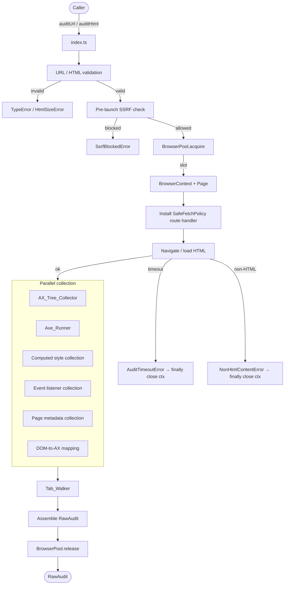

# Design Document — Audit Engine

## Overview

The audit engine is the browser automation layer of `packages/core`. It accepts a URL or raw HTML string, launches a Playwright Chromium browser in a managed pool, collects every raw signal the classifier needs, and returns a single serializable `RawAudit` object. No haunting classification, severity scoring, or speech generation belongs here — that is the classifier's job.

The engine is split into five runner modules under `packages/core/src/runner/`:

| Module | Responsibility |
|--------|---------------|
| `browser.ts` | Browser context lifecycle, viewport, screenshot, bounding boxes, `auditHtml` local server |
| `ax-tree.ts` | CDP `Accessibility.getFullAXTree` → typed `AXNode[]` |
| `axe.ts` | `@axe-core/playwright` injection, `AxeViolation[]` normalisation |
| `tab-walker.ts` | Tab keypress simulation, `FocusSnapshot` capture, cycle detection, escape test |
| `safe-fetch.ts` | `SafeFetchPolicy` interface, restrictive implementation (SSRF guard), permissive implementation (local MCP) |

The two public entry points — `auditUrl` and `auditHtml` — are exported from `packages/core/src/index.ts`. All shared domain types live in `packages/core/src/types.ts`.

The classifier in `packages/core/src/classifier/` reads `RawAudit` and nothing else. It never imports from `runner/`.

---

## Architecture

### Top-level flow



### Module dependencies

```
index.ts
  └── runner/browser.ts        (Page_Loader, BrowserPool)
  └── runner/ax-tree.ts        (AX_Tree_Collector)
  └── runner/axe.ts            (Axe_Runner)
  └── runner/tab-walker.ts     (Tab_Walker)
  └── runner/safe-fetch.ts     (SafeFetchPolicy interface + implementations)
  └── types.ts                 (all shared types and error classes)

classifier/ (separate package boundary — imports types.ts only, never runner/)
```

### Classifier boundary

**Nothing in `packages/core/src/classifier/` may import from `packages/core/src/runner/`.** The `RawAudit` type (from `types.ts`) is the sole interface between them. The runner assembles data; the classifier interprets it. This boundary is enforced by TypeScript path alias restrictions in `packages/core/tsconfig.json`:

```json
{
  "compilerOptions": {
    "paths": {
      "@runner/*": ["./src/runner/*"]
    }
  }
}
```

A CI check (`tsc --noEmit`) on the classifier files, combined with ESLint `no-restricted-imports`, ensures no classifier file contains a path starting with `../runner/` or `@runner/`.

---

## Components and Interfaces

### `runner/browser.ts` — Page_Loader

Responsible for the full browser context lifecycle for one audit:

1. Create a `BrowserContext` from the pool's shared `Browser` instance with settings:
   - `viewport: { width: 1280, height: 900 }` (overridable via `AuditOptions`)
   - `locale: "en-US"`, `timezoneId: "UTC"`
   - `serviceWorkers: "block"`, `bypassCSP: false`
   - No persistent storage (`storageState: undefined`)
2. Open a `Page` on that context.
3. Install the `SafeFetchPolicy` route handler before any navigation.
4. For `auditUrl`: call `page.goto(url, { waitUntil: 'networkidle', timeout: navigationTimeoutMs })`.
5. For `auditHtml`: start a local in-process HTTP server (Node `http.createServer`) on a random available port, serve the HTML string at `/`, then call `page.goto('http://localhost:{port}/')`.
6. Verify the response Content-Type is `text/html` or `application/xhtml+xml`; throw `NonHtmlContentError` otherwise.
7. Take a full-page PNG screenshot: `page.screenshot({ fullPage: true, type: 'png' })`.
8. Collect bounding boxes for all DOM nodes via a single `page.evaluate` call that iterates `document.querySelectorAll('*')` and reads `getBoundingClientRect()` plus the CDP `backendDOMNodeId` for each.
9. Close the `BrowserContext` in a `finally` block regardless of outcome.

The module also exports the `normalizeBoundingBox` pure helper function used in tests.

### `runner/ax-tree.ts` — AX_Tree_Collector

1. Opens a CDP session on the page: `page.context().newCDPSession(page)`.
2. Calls `session.send('Accessibility.getFullAXTree', { fetchRelatedNodes: true })`.
3. Maps every CDP node to an `AXNode`, preserving all fields verbatim.
4. Validates that every node has a `backendDOMNodeId`; throws `AuditCollectionError` with `step: "ax-tree"` if any node is missing it.
5. Validates that at least one node is returned when `document.body.children.length > 0`; throws `AuditCollectionError` with `step: "ax-tree"` if zero nodes are returned.
6. Returns the full `AXNode[]` in CDP's original order.

### `runner/axe.ts` — Axe_Runner

1. Imports `AxeBuilder` from `@axe-core/playwright`.
2. Configures it with `runOnly: { type: 'tag', values: ['wcag2a', 'wcag2aa', 'wcag21a', 'wcag21aa', 'wcag22aa'] }`.
3. Calls `.analyze()` with a 30-second timeout; on failure or timeout, records the error in `collectionErrors` and returns empty arrays.
4. Normalises `violations` and `incomplete` into `AxeViolation[]`; discards `passes` and `inapplicable`.
5. Coerces `impact` values not in `["minor", "moderate", "serious", "critical"]` to `null`.

### `runner/tab-walker.ts` — Tab_Walker

The Tab_Walker performs real keyboard simulation via Playwright's `keyboard.press('Tab')` and reads focus state via CDP after each keypress.

Pre-walk steps:
1. Wait for `networkidle` plus a **1500 ms settle window** so that timer-triggered dialogs (e.g. newsletter popups) are present before the walk starts. Record the absolute timestamp as `walkStartedAtMs`.
2. Inject the CSS rule `*,*::before,*::after{transition:none!important;animation:none!important}` into the page to prevent transition durations from corrupting the before/after style comparison.
3. Count focusable elements via `page.evaluate` → `focusableCount`.
4. Compute step cap: `focusableCount * 2 + 10`.
5. Enumerate `backendDOMNodeId` values of all focusable elements → `focusableSet`.

Walk loop (see Tab Walker Cycle Detection Algorithm section for detail):
- Each iteration: capture `before` styles → `keyboard.press('Tab')` → read `activeElement` via CDP → capture `after` styles → record `TabStep`.
- Collected style properties: `outline-style`, `outline-width`, `outline-color`, `outline-offset`, `box-shadow`, `border-color`, `background-color`, `text-decoration`.
- Cycle detection: if the same `backendDOMNodeId` appears a second time before `focusableSet` is fully visited, run the escape test.
- Escape test: `keyboard.press('Escape')` → `keyboard.press('Shift+Tab')` → read `activeElement`.
- After escape test: if escapable, **reset cycle detection** (begin a new walk segment from the new focus position) and continue; otherwise declare trap and stop.
- The step cap applies to the cumulative step count across all segments.

The module also exports two pure helper functions for property testing:
- `detectCycle(steps, focusableCount)` — pure cycle detection on a sequence of IDs
- `stepCap(focusableCount)` — the step cap formula

### `runner/safe-fetch.ts` — SafeFetchPolicy

Exports:
- `SafeFetchPolicy` interface
- `RestrictiveSafeFetchPolicy` — resolves hostnames, blocks all private/loopback/link-local/cloud-metadata IPs and all non-http(s) schemes
- `PermissiveSafeFetchPolicy` — allows loopback and private IPs; still blocks non-http(s) schemes

The `RestrictiveSafeFetchPolicy` performs DNS resolution using Node's `dns.promises.resolve4` and `resolve6` before the first navigation and for every intercepted request. It compares the resolved IPs against all blocked ranges from `security.md`, handling all address encodings (hex, octal, decimal, IPv4-mapped IPv6, 6to4).

Installation helper:
```typescript
export function installSafeFetchPolicy(page: Page, policy: SafeFetchPolicy): void
```
Calls `page.route('**/*', handler)` where `handler` calls `policy.shouldBlock(url)` and either `route.continue()` or `route.abort()`.

### `browser.ts` — Browser Pool (embedded)

A singleton `BrowserPool` class manages a fixed pool of Playwright `Browser` instances. It lives in `browser.ts` alongside `Page_Loader` or in a co-located `browser-pool.ts`; either placement is acceptable as long as it is not exported beyond `runner/`.

Design:
- Pool singleton initialized on first call to `auditUrl` or `auditHtml`.
- Tracks `availableSlots`, `pendingQueue`, and a `sessionCounter` per browser instance.
- Uses a Promise-based queue: each `acquire()` call either resolves immediately (slot available) or enqueues a `{ resolve, reject }` pair with a 30-second timeout.
- On `release()`: runs a health check (`browser.isConnected()`); if unhealthy, closes and replaces the instance. If `sessionCounter >= 50`, closes and replaces the instance.
- Maximum queue depth: 50. Reject immediately if exceeded.

---

## Data Models

All types are declared in `packages/core/src/types.ts` and re-exported as needed from `packages/core/src/index.ts`.

### Complete type definitions

```typescript
// Schema version literal — increment when a breaking change is made
type SchemaVersion = "1"

// Top-level audit result
type RawAudit = {
  schemaVersion: SchemaVersion
  auditedUrl: string
  auditedAt: string                                        // ISO 8601
  screenshotPng: string                                    // base64-encoded PNG
  viewportWidth: number
  viewportHeight: number
  boundingBoxes: BoundingBox[]
  axNodes: AXNode[]
  axeViolations: AxeViolation[]
  axeIncomplete: AxeViolation[]
  textNodeStyles: Record<string, TextNodeStyle>            // keyed by backendDOMNodeId (string)
  elementCursorStyles: Record<string, string>             // keyed by backendDOMNodeId (string)
  imgAltAttributes: Record<string, string | null>         // keyed by backendDOMNodeId; null = absent
  eventListenerSignals: EventListenerSignal[]
  tabWalkResult: TabWalkResult
  pageMetadata: PageMetadata
  domAxMapping: DomAxMapping[]
  resourceUsage: ResourceUsage
  blockedRequests: Array<{ url: string; reason: string }>
  abortedResources: string[]
  collectionErrors: CollectionError[]
}

// AX node from CDP Accessibility.getFullAXTree
type AXNode = {
  nodeId: string
  backendDOMNodeId: number
  role: AXValue
  name: AXValue
  description: AXValue
  properties: AXProperty[]
  states: AXProperty[]
  ignored: boolean
  ignoredReasons: AXProperty[]
  childIds: string[]
  parentId: string | undefined
}

type AXValue = {
  type: string
  value: string | boolean | number | undefined
  sources?: AXValueSource[]
}

type AXValueSource = {
  type: string
  value?: AXValue
  attribute?: string
  attributeValue?: AXValue
  superseded?: boolean
  nativeSource?: string
  nativeSourceValue?: AXValue
  invalid?: boolean
  invalidReason?: string
}

type AXProperty = {
  name: string
  value: AXValue
}

// Bounding box in screenshot pixel coordinates
type BoundingBox = {
  backendDOMNodeId: number
  x: number
  y: number
  width: number
  height: number
}

// Tab walk output
type TabWalkResult = {
  steps: TabStep[]
  trapDetected: boolean
  trapRegionNodeIds: string[]          // backendDOMNodeIds in the trap region
  stepCapReached: boolean
  cycles: TabCycle[]
  walkStartedAtMs: number              // Unix epoch ms when the walk began (after settle window)
}

type TabStep = {
  index: number                        // 0-based step counter
  backendDOMNodeId: string
  focusSnapshot: FocusSnapshot
  cdpError: boolean                    // true if CDP read failed for this step
}

type FocusSnapshot = {
  before: ComputedStyleMap             // styles captured before Tab keypress
  after: ComputedStyleMap              // styles captured after focus arrives
  // Captured properties: outline-style, outline-width, outline-color, outline-offset,
  // box-shadow, border-color, background-color, text-decoration
}

type ComputedStyleMap = Record<string, string>  // CSS property → computed value

type TabCycle = {
  nodeIds: string[]                    // backendDOMNodeIds forming the cycle
  startStepIndex: number
  escapable: boolean
}

// Cycle detection result (pure function output)
type CycleResult = {
  hasCycle: boolean
  cycleStart: number                   // index of first repeat, or -1
  cycleNodeIds: string[]
}

// Text node computed styles for contrast detection
type TextNodeStyle = {
  color: string
  backgroundColor: string             // effective (resolved from transparent ancestors)
  fontSize: string                    // e.g. "16px"
  fontWeight: string                  // e.g. "400"
}

// Click/pointer event listener presence on a node
type EventListenerSignal = {
  backendDOMNodeId: number
  eventTypes: Array<"click" | "mousedown" | "pointerdown" | "pointerup">
  tagName: string
}

// DOM-to-AX presence mapping for The Veiled detection
type DomAxMapping = {
  backendDOMNodeId: number
  tagName: string
  hasAxNode: boolean
  ariaHidden: boolean
  isPresentational: boolean
  isFocusable: boolean
}

// Page-level metadata for Silent Tongue and Shattered Order
type PageMetadata = {
  htmlLang: string | null
  headings: HeadingRecord[]
  landmarkRoles: string[]
}

type HeadingRecord = {
  tagName: string                      // "h1" – "h6"
  accessibleName: string
  domOrderIndex: number                // 0-based position among all headings
}

// Network resource usage counters
type ResourceUsage = {
  totalBytes: number
  requestCount: number
  maxResourceBytes: number
  responseTimings: Array<{ url: string; bytesReceived: number; durationMs: number }>
}

// Non-fatal collection error recorded in RawAudit
type CollectionError = {
  step: "ax-tree" | "axe" | "event-listeners" | "text-styles" | "dom-ax-mapping" | "tab-walk"
  message: string
  backendDOMNodeId?: number
}

// axe-core violation (normalised)
type AxeViolation = {
  id: string
  impact: "minor" | "moderate" | "serious" | "critical" | null
  tags: string[]
  description: string
  helpUrl: string
  nodes: AxeViolationNode[]
}

type AxeViolationNode = {
  html: string
  target: string[]                     // CSS selector path
  failureSummary: string
}

// Public API options
type AuditOptions = {
  allowPrivate?: boolean               // default false
  timeoutMs?: number                   // default 60000
  navigationTimeoutMs?: number         // default 30000
  safeFetchPolicy?: SafeFetchPolicy    // override for testing
  viewport?: { width: number; height: number }  // default 1280×900
}

// SSRF guard interface
interface SafeFetchPolicy {
  shouldBlock(url: string): Promise<{ block: boolean; reason: string }>
}

// Typed error classes
class AuditTimeoutError extends Error {
  constructor(
    public readonly operation: string,
    public readonly elapsedMs: number
  ) { super(`Audit timeout: ${operation} exceeded ${elapsedMs}ms`) }
}

class SsrfBlockedError extends Error {
  constructor(
    public readonly url: string,
    public readonly reason: string
  ) { super(`SSRF blocked: ${url} — ${reason}`) }
}

class AuditResourceLimitError extends Error {
  constructor(
    public readonly limitType: "request-count" | "total-weight" | "per-resource",
    public readonly value: number
  ) { super(`Resource limit exceeded: ${limitType} = ${value}`) }
}

class NonHtmlContentError extends Error {
  constructor(public readonly contentType: string) {
    super(`Non-HTML content type: ${contentType}`)
  }
}

class AuditCollectionError extends Error {
  constructor(
    public readonly step: string,
    public readonly cause: unknown
  ) { super(`Collection error in step "${step}"`) }
}

class AuditContextError extends Error {
  constructor(public readonly cause: unknown) {
    super('Failed to create browser context')
  }
}

class HtmlSizeError extends Error {
  constructor(public readonly byteLength: number) {
    super(`HTML input too large: ${byteLength} bytes (max 10485760)`)
  }
}
```

---

## Sequence Diagram

One complete `auditUrl(url, options)` call, including parallel collection and error paths:

```mermaid
sequenceDiagram
    participant Caller
    participant index as index.ts (auditUrl)
    participant safe as safe-fetch.ts
    participant pool as BrowserPool
    participant loader as Page_Loader (browser.ts)
    participant axt as AX_Tree_Collector
    participant axe as Axe_Runner
    participant styles as Style Collector
    participant events as Event Listener Collector
    participant meta as Metadata Collector
    participant mapping as DOM-AX Mapper
    participant walker as Tab_Walker

    Caller->>index: auditUrl(url, options)
    index->>index: new URL(url) — TypeError if invalid
    index->>index: check protocol — TypeError if not http/https
    index->>safe: policy.shouldBlock(url) [pre-launch SSRF check]
    alt SSRF blocked
        safe-->>index: { block: true, reason }
        index-->>Caller: throw SsrfBlockedError
    end
    index->>pool: acquire(timeoutMs)
    Note over pool: queue if at cap; reject after 30s wait
    pool-->>index: browser instance slot
    index->>loader: createContext(browser, options)
    alt BrowserContext creation fails
        loader-->>index: throw AuditContextError
        index->>pool: release(slot)
        index-->>Caller: throw AuditContextError
    end
    loader->>safe: installSafeFetchPolicy(page, policy)
    loader->>loader: page.goto(url, {waitUntil:'networkidle', timeout:navTimeout})
    alt Navigation timeout
        loader-->>index: throw AuditTimeoutError("navigation", elapsedMs)
        index->>loader: finally: context.close()
        index->>pool: release(slot)
        index-->>Caller: throw AuditTimeoutError
    end
    alt Non-HTML content type
        loader-->>index: throw NonHtmlContentError(contentType)
        index->>loader: finally: context.close()
        index->>pool: release(slot)
        index-->>Caller: throw NonHtmlContentError
    end
    loader->>loader: page.screenshot() → screenshotPng
    loader->>loader: collect BoundingBoxes via page.evaluate

    par Parallel data collection (all within 60s total timeout)
        index->>axt: getFullAXTree(cdpSession)
        axt-->>index: AXNode[]
    and
        index->>axe: runAxe(page)
        axe-->>index: { violations, incomplete }
    and
        index->>styles: collectTextNodeStyles(page)
        styles-->>index: textNodeStyles, elementCursorStyles
    and
        index->>events: collectEventListeners(cdpSession)
        events-->>index: EventListenerSignal[]
    and
        index->>meta: collectPageMetadata(page, axNodes)
        meta-->>index: PageMetadata, imgAltAttributes
    and
        index->>mapping: buildDomAxMapping(page, axNodes)
        mapping-->>index: DomAxMapping[]
    end

    index->>walker: walkTabs(page, cdpSession, focusableCount)
    walker-->>index: TabWalkResult

    index->>index: assemble RawAudit (base64-encode screenshotPng)
    index->>loader: finally: context.close()
    index->>pool: release(slot)
    index-->>Caller: RawAudit
```

---

## Error Handling

### Error class table

| Error Class | Extends | Fields | When Thrown | Fatal? |
|-------------|---------|--------|-------------|--------|
| `AuditTimeoutError` | `Error` | `operation: string`, `elapsedMs: number` | Navigation exceeds 30s; full audit exceeds 60s; browser crash detected | Fatal — throws, closes context |
| `SsrfBlockedError` | `Error` | `url: string`, `reason: string` | Pre-launch SSRF check blocks the initial URL | Fatal — throws before pool acquire |
| `AuditResourceLimitError` | `Error` | `limitType: "request-count" \| "total-weight" \| "per-resource"`, `value: number` | Request count >500 or total bytes >50 MB | Fatal — throws, closes context |
| `NonHtmlContentError` | `Error` | `contentType: string` | Initial response Content-Type is not HTML; non-http(s) scheme | Fatal — throws, closes context |
| `AuditCollectionError` | `Error` | `step: string`, `cause: unknown` | CDP `Accessibility.getFullAXTree` fails; CDP session unavailable | Fatal for ax-tree; non-fatal (recorded in `collectionErrors`) for axe, event listeners, style collection, DOM-AX mapping |
| `AuditContextError` | `Error` | `cause: unknown` | `BrowserContext` creation fails | Fatal — throws, releases pool slot |
| `HtmlSizeError` | `Error` | `byteLength: number` | `auditHtml` called with HTML >10 MB | Fatal — throws before pool acquire |
| `TypeError` (built-in) | `Error` | (standard) | `auditUrl` called with an unparseable URL or non-http(s) protocol | Fatal — throws before pool acquire |

### Non-fatal collection errors

The following steps are non-fatal: when they fail, the error is recorded in `RawAudit.collectionErrors` and the audit continues with the remaining steps. The returned `RawAudit` has the failed field set to an empty array or object:

- `axe` — axe-core injection/execution failure or timeout
- `event-listeners` — CDP `DOMDebugger.getEventListeners` failure
- `text-styles` — `page.evaluate` batch failure for computed styles
- `dom-ax-mapping` — DOM-to-AX mapping construction failure

The following steps are fatal: failure causes `auditUrl`/`auditHtml` to throw and no `RawAudit` is returned:

- Page navigation (`goto`)
- Screenshot capture
- CDP `Accessibility.getFullAXTree`

### Context cleanup invariant

Every code path that creates a `BrowserContext` must close it in a `finally` block. No context is ever returned to the pool — only the browser *slot* is returned. Each audit always creates a fresh context and always closes it.

---

## Browser Pool Design

### Singleton pattern

`BrowserPool` is instantiated once per process (Node.js module-level singleton). The first call to `auditUrl` or `auditHtml` triggers lazy initialization. Subsequent calls share the same instance. This ensures that concurrent calls from the Fastify server and the MCP server draw from one shared pool.

```typescript
let poolInstance: BrowserPool | undefined

export function getPool(options?: BrowserPoolOptions): BrowserPool {
  if (!poolInstance) poolInstance = new BrowserPool(options ?? defaultOptions)
  return poolInstance
}
```

### Queue implementation

The pool maintains a simple Promise-based queue:

```typescript
type QueueEntry = {
  resolve: (browser: Browser) => void
  reject: (err: Error) => void
  timeoutHandle: ReturnType<typeof setTimeout>
}

class BrowserPool {
  private available: Browser[] = []
  private queue: QueueEntry[] = []
  private sessionCounters: WeakMap<Browser, number> = new WeakMap()
  private busyCount = 0

  async acquire(): Promise<Browser> {
    if (this.available.length > 0) {
      const browser = this.available.shift()!
      this.busyCount++
      return browser
    }
    if (this.busyCount < this.maxConcurrency) {
      const browser = await chromium.launch()
      this.sessionCounters.set(browser, 0)
      this.busyCount++
      return browser
    }
    if (this.queue.length >= MAX_QUEUE_DEPTH /* 50 */) {
      throw new Error('BrowserPool at capacity')
    }
    return new Promise<Browser>((resolve, reject) => {
      const timeoutHandle = setTimeout(() => {
        this.queue = this.queue.filter(e => e.resolve !== resolve)
        reject(new Error('BrowserPool queue timeout'))
      }, QUEUE_TIMEOUT_MS /* 30000 */)
      this.queue.push({ resolve, reject, timeoutHandle })
    })
  }
}
```

### Health check and release

On `release(browser)`:

1. Increment the browser's session counter.
2. Run health check: `browser.isConnected()`.
3. If unhealthy OR session counter ≥ 50: close the browser (`browser.close()`), decrement `busyCount`, launch a fresh replacement before dispatching to the next queued request.
4. If healthy and counter < 50: add browser to `available`, decrement `busyCount`, dispatch to next queued request if any.

### Session counter recycling

After 50 audit sessions, a browser instance is considered stale and is replaced. This prevents memory leaks from accumulated browser-side state. The replacement happens asynchronously on release so it does not block the returning audit.

---

## Tab Walker Cycle Detection Algorithm

### Walk procedure (pseudocode)

```
function walkTabs(page, cdpSession, focusableCount):
  // 1. Settle window so timer-triggered dialogs are present
  await waitForNetworkIdle()
  await sleep(1500)
  walkStartedAtMs = Date.now()

  // 2. Suppress transitions so before/after style reads are stable
  await page.addStyleTag({ content: '*,*::before,*::after{transition:none!important;animation:none!important}' })

  focusableSet = enumerateFocusableNodeIds(page)   // Set<string>
  visitedSet = new Set<string>()
  steps = []
  cap = stepCap(focusableCount)                     // focusableCount * 2 + 10

  if focusableCount == 0:
    return { steps: [], trapDetected: false, stepCapReached: false, cycles: [], walkStartedAtMs }

  while steps.length < cap:
    before = readFocusStyles(cdpSession)
    press Tab
    nodeId = readActiveElement(cdpSession)

    if nodeId == null or nodeId == body:
      break  // natural end of walk

    after = readFocusStyles(cdpSession)
    steps.push(TabStep(nodeId, steps.length, { before, after }))

    if nodeId in visitedSet and not all of focusableSet has been visited:
      // Potential trap — run escape test
      escapeResult = runEscapeTest(cdpSession)
      if escapeResult not in cycle node set:
        // Escapable modal (compliant): reset cycle detection and continue
        record TabCycle(escapable: true)
        visitedSet = new Set<string>()   // reset for the new segment
        // continue walk from escapeResult (next Tab will move from there)
        continue
      else:
        // Keyboard trap confirmed
        trapRegionNodeIds = cycleNodeIds
        return { steps, trapDetected: true, trapRegionNodeIds, stepCapReached: false, cycles: [...], walkStartedAtMs }

    visitedSet.add(nodeId)

  stepCapReached = (steps.length >= cap)
  return { steps, trapDetected: false, trapRegionNodeIds: [], stepCapReached, cycles: [], walkStartedAtMs }
```

### Step cap enforcement

The step cap is computed by the pure function:

```typescript
export function stepCap(focusableCount: number): number {
  return focusableCount * 2 + 10
}
```

When the cap is reached, the walker stops and sets `stepCapReached: true` in `TabWalkResult`. It does not declare a trap solely because the cap was reached.

### Escape test procedure

```
function runEscapeTest(cdpSession):
  press Escape
  press Shift+Tab
  return readActiveElement(cdpSession)
```

If the resulting `activeElement.backendDOMNodeId` is **not** a member of the candidate cycle's node set, the cycle is classified as `escapable: true` — a modal with a working Escape key is compliant with WCAG 2.1.2. The walker resumes from that element.

If the resulting `activeElement.backendDOMNodeId` **is** a member of the candidate cycle's node set (or if no element is focused), a keyboard trap is declared.

### Pure helper: `detectCycle`

This function is extracted from the walker loop for property-based testing:

```typescript
type CycleResult = {
  hasCycle: boolean
  cycleStart: number       // index of the first repeated step, or -1
  cycleNodeIds: string[]   // IDs forming the cycle
}

function detectCycle(steps: readonly string[], focusableCount: number): CycleResult
```

Logic:
1. Build `focusableSet` by scanning the first `focusableCount` unique IDs in `steps`.
2. Walk `steps` with a running `visitedSet`.
3. If a step ID is already in `visitedSet` AND `visitedSet.size < focusableCount`, return `{ hasCycle: true, cycleStart: i, cycleNodeIds: [...members of visitedSet since first occurrence] }`.
4. If the walk completes without that condition, return `{ hasCycle: false, cycleStart: -1, cycleNodeIds: [] }`.

This function is pure (no I/O, no globals, no `Date.now()`). It lives in `tab-walker.ts` and is exported as a named export alongside the main `Tab_Walker` logic.

---

## Correctness Properties

*A property is a characteristic or behavior that should hold true across all valid executions of a system — essentially, a formal statement about what the system should do. Properties serve as the bridge between human-readable specifications and machine-verifiable correctness guarantees.*

The audit engine's runner layer is primarily I/O-bound (browser automation, CDP calls), so the vast majority of its logic is not suitable for property-based testing. However, three pure helper functions extracted for testability are excellent candidates: `detectCycle`, `stepCap`, and `normalizeBoundingBox`. All correctness properties below target these pure functions.

### Property 1: detectCycle — no-cycle invariant

*For any* sequence of step IDs with no repeated element, `detectCycle` SHALL return `{ hasCycle: false }` and the same result for any permutation of the same unique IDs (determinism).

**Validates: Requirements 11.3, 11.4** — a walk with no revisited node cannot be a trap; the function is deterministic (same inputs → same output).

### Property 2: detectCycle — cycle detection before full visit

*For any* sequence of step IDs that contains at least one repeat, where the repeat occurs before all `focusableCount` unique IDs have been seen at least once, `detectCycle` SHALL return `{ hasCycle: true }` with a non-empty `cycleNodeIds` array.

**Validates: Requirements 11.4** — the Tab_Walker must detect a cycle exactly when the same `backendDOMNodeId` appears a second time before all focusable elements have been visited.

### Property 3: detectCycle — cycleNodeIds subset invariant

*For any* input to `detectCycle`, every ID in `cycleNodeIds` SHALL also appear in `steps`.

**Validates: Requirements 11.4, 11.6** — cycle node IDs reported to the classifier must be drawn only from actually observed focus steps, never from fabricated data.

### Property 4: stepCap invariants

*For any* non-negative integer `n`:
- `stepCap(0) === 10`
- `stepCap(n) > stepCap(n - 1)` for all `n > 0` (strictly monotone)
- `stepCap(n) >= 10` always

**Validates: Requirements 11.3** — the walk cap formula is monotone in `focusableCount` and always provides a minimum of 10 steps even on pages with zero focusable elements.

### Property 5: normalizeBoundingBox invariants

*For any* bounding box and any positive viewport scale factor, `normalizeBoundingBox(box, scale)` SHALL produce output where `x >= 0`, `y >= 0`, `width >= 0`, `height >= 0`, and both `width` and `height` are equal to the input multiplied by the scale factor (linear transform applied uniformly).

**Validates: Requirements 1.3, 1.4** — bounding box coordinates must be non-negative and must scale linearly so that classifier coordinate math is predictable.

---

## Testing Strategy

### Dual approach

Both integration tests (Playwright Test) and property-based tests (fast-check + Vitest) are required. They are complementary: integration tests catch real-world pipeline failures; property tests verify correctness of the pure logic under arbitrarily generated inputs.

### Integration tests (Playwright Test)

**Location:** `packages/core/tests/`

**Fixture pages:** `apps/cursed-shop/index.html` and `apps/cursed-shop/checkout.html`, loaded via a local static file server started within the test process (e.g., using the `serve-static` npm package or a plain `http.createServer`). The server MUST start within 10 seconds of test process startup or the entire suite aborts.

**One test per haunting type** — each test confirms that the specific raw data field needed for that haunting is populated. The mapping is:

| Haunting | Required RawAudit field |
|----------|------------------------|
| Nameless Spirit | `axNodes` contains ≥1 node with interactive role and empty `name.value` |
| Hollow Portrait | `imgAltAttributes` contains ≥1 entry where value is `null` and `axNodes` has a matching `img` role |
| The Fog | `textNodeStyles` contains ≥1 entry with contrast-failing color/bg combination |
| Lost Soul | `eventListenerSignals` contains ≥1 entry AND that `backendDOMNodeId` is absent from `tabWalkResult.steps` |
| Cursed Loop | `tabWalkResult.trapDetected === true` and `trapRegionNodeIds.length > 0` |
| Invisible Wanderer | `tabWalkResult.steps` contains ≥1 step where `before` and `after` focus snapshot styles are identical (no visible focus indicator after contrast check) |
| Whispering Field | `axNodes` contains ≥1 node with `textbox`/`searchbox`/`spinbutton`/`slider`/`combobox` role and either an empty `name.value` or a `name.sources` entry where the winning source is `placeholder` |
| Silent Tongue | `pageMetadata.htmlLang` is `null` or empty |
| Shattered Order | `pageMetadata.headings` has a gap in heading levels |
| The Veiled | `domAxMapping` contains ≥1 entry where `hasAxNode === false` and `ariaHidden === false` |

**Structural assertions** (run against both fixtures):
- `RawAudit.schemaVersion === "1"`
- `RawAudit.collectionErrors` is empty under normal conditions
- `RawAudit.screenshotPng` is a non-empty string
- `RawAudit.viewportWidth === 1280` and `RawAudit.viewportHeight === 900`
- Every `BoundingBox` has a non-zero `backendDOMNodeId`
- `RawAudit` is JSON-round-trip-safe (`JSON.parse(JSON.stringify(rawAudit))` is deep-equal for all scalar fields)

### Property-based tests (fast-check + Vitest)

**Location:** alongside the source file — `tab-walker.test.ts`, `browser.test.ts`.

**Library:** `fast-check` (already in devDependencies per `tech.md`).

**Minimum iterations:** 100 per property test.

Each property test references its design document property in a comment:
```typescript
// Feature: audit-engine, Property 1: detectCycle — no-cycle invariant
```

**Property 1 — detectCycle no-cycle invariant** (`tab-walker.test.ts`):
```typescript
fc.property(
  fc.array(fc.uniqueArray(fc.string(), { minLength: 1 })),
  (uniqueSteps) => {
    const result = detectCycle(uniqueSteps, uniqueSteps.length)
    return result.hasCycle === false
  }
)
```

**Property 2 — detectCycle cycle detection** (`tab-walker.test.ts`):
Generate a sequence where a repeat appears before `focusableCount` unique IDs have been visited:
```typescript
fc.property(
  fc.integer({ min: 2, max: 20 }).chain(n =>
    fc.tuple(
      fc.array(fc.string({ minLength: 1 }), { minLength: n, maxLength: n }),
      fc.integer({ min: 0, max: n - 2 })
    ).map(([ids, repeatAt]) => {
      const steps = [...ids.slice(0, repeatAt + 1), ids[0], ...ids.slice(repeatAt + 1)]
      return { steps, focusableCount: n + 1 }
    })
  ),
  ({ steps, focusableCount }) => {
    const result = detectCycle(steps, focusableCount)
    return result.hasCycle === true && result.cycleNodeIds.length > 0
  }
)
```

**Property 3 — cycleNodeIds subset** (`tab-walker.test.ts`):
```typescript
fc.property(
  fc.array(fc.string({ minLength: 1 }), { maxLength: 50 }),
  fc.integer({ min: 0, max: 50 }),
  (steps, focusableCount) => {
    const result = detectCycle(steps, focusableCount)
    return result.cycleNodeIds.every(id => steps.includes(id))
  }
)
```

**Property 4 — stepCap invariants** (`tab-walker.test.ts`):
```typescript
// Feature: audit-engine, Property 4: stepCap invariants
fc.property(fc.nat(1000), (n) => {
  const cap = stepCap(n)
  const prevCap = stepCap(n > 0 ? n - 1 : 0)
  return cap >= 10 && (n === 0 || cap > prevCap)
})
// Also assert stepCap(0) === 10 as a unit test example
```

**Property 5 — normalizeBoundingBox invariants** (`browser.test.ts`):
```typescript
// Feature: audit-engine, Property 5: normalizeBoundingBox invariants
fc.property(
  fc.record({
    x: fc.float({ min: 0, max: 10000 }),
    y: fc.float({ min: 0, max: 10000 }),
    width: fc.float({ min: 0, max: 5000 }),
    height: fc.float({ min: 0, max: 5000 }),
  }),
  fc.float({ min: 0.1, max: 10 }),
  (box, scale) => {
    const result = normalizeBoundingBox(box, scale)
    return result.x >= 0 && result.y >= 0 && result.width >= 0 && result.height >= 0
      && Math.abs(result.width - box.width * scale) < 0.001
      && Math.abs(result.height - box.height * scale) < 0.001
  }
)
```

### Unit tests (example-based)

Located alongside source files (`*.test.ts`). Cover:
- `AuditTimeoutError`, `SsrfBlockedError`, etc. instantiate correctly with expected fields
- `auditUrl` with invalid URL throws `TypeError`
- `auditUrl` with `file:` scheme throws `TypeError`
- `auditHtml` with HTML > 10 MB throws `HtmlSizeError`
- `AxeViolation` normalisation coerces unknown `impact` values to `null`
- `BrowserPool` queue depth limit throws immediately at 51st pending request

### Vitest configuration

`packages/core/vitest.config.ts`:
```typescript
import { defineConfig } from 'vitest/config'

export default defineConfig({
  test: {
    include: ['src/**/*.test.ts'],
    exclude: ['tests/**'],          // integration tests run via Playwright Test
    environment: 'node',
  },
})
```

Integration tests in `packages/core/tests/` run via `@playwright/test`, not Vitest.

---

## Monorepo Scaffold

If the workspace root `package.json` does not exist, the first implementation task scaffolds the monorepo before writing any application code.

### Root `package.json`

```json
{
  "name": "the-unseen",
  "private": true,
  "workspaces": ["packages/*", "apps/*"],
  "engines": { "node": ">=22" },
  "scripts": {
    "build": "npm run build --workspaces --if-present",
    "test": "npm run test --workspaces --if-present",
    "typecheck": "npm run typecheck --workspaces --if-present"
  }
}
```

### Root `tsconfig.base.json`

```json
{
  "compilerOptions": {
    "strict": true,
    "target": "ES2022",
    "module": "NodeNext",
    "moduleResolution": "NodeNext",
    "noEmit": false,
    "declaration": true,
    "declarationMap": true,
    "sourceMap": true,
    "esModuleInterop": true,
    "skipLibCheck": false,
    "forceConsistentCasingInFileNames": true
  }
}
```

### `packages/core/package.json`

```json
{
  "name": "@the-unseen/core",
  "version": "0.1.0",
  "type": "module",
  "main": "./dist/index.js",
  "types": "./dist/index.d.ts",
  "scripts": {
    "build": "tsc",
    "test": "vitest --run",
    "typecheck": "tsc --noEmit",
    "test:integration": "playwright test"
  },
  "dependencies": {
    "playwright": "^1.44.0"
  },
  "devDependencies": {
    "@axe-core/playwright": "^4.9.0",
    "@playwright/test": "^1.44.0",
    "fast-check": "^3.19.0",
    "typescript": "^5.4.0",
    "vitest": "^1.6.0"
  }
}
```

### `packages/core/tsconfig.json`

```json
{
  "extends": "../../tsconfig.base.json",
  "compilerOptions": {
    "outDir": "./dist",
    "rootDir": "./src"
  },
  "include": ["src/**/*.ts"],
  "exclude": ["**/*.test.ts", "tests/**", "dist/**"]
}
```

### `packages/core/vitest.config.ts`

```typescript
import { defineConfig } from 'vitest/config'

export default defineConfig({
  test: {
    include: ['src/**/*.test.ts'],
    environment: 'node',
    reporter: ['verbose'],
  },
})
```
